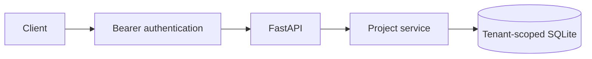
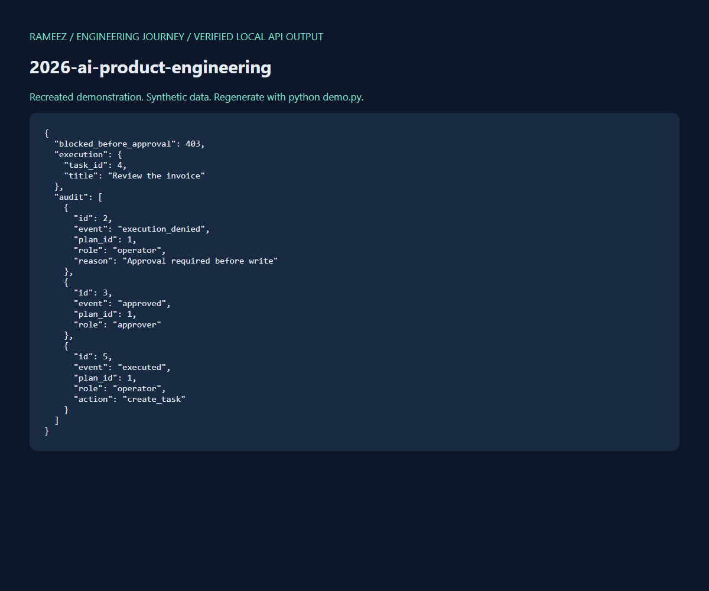

# 2026 - MCP Multi-Agent Business Automation

## Project Summary

Business agents need bounded access to tools and review before writes. A local MCP server exposes planning and execution while a separate API handles human approval, permissions and audit records.

## Career Context

**Original experience period: 2026.** This is a recreated, modernized demonstration of engineering patterns associated with this career stage. Earlier professional work was primarily in private client/company repositories. This is not an original employer/client codebase. All new commits use their actual dates. This repository remains private by the owner's instruction.

## Architecture



Service flow: **Planner -> permission and approval review -> executor -> audit**. See [design notes](docs/architecture.md).

## Features

Real stdio MCP server; allowlisted report/task tools; server-configured roles; separate approval API; tenant isolation; transactional execution; idempotent replay; durable allow/deny audit.

## Tech Stack

- Frontend: API client and interactive OpenAPI docs.
- Backend: Python 3.14, FastAPI, Pydantic.
- AI/ML and data: MCP Python SDK 2.x; SQLite.
- Infrastructure: local Python environment, Dockerfile, GitHub Actions tests.

## My Contributions

Implemented tool schemas, permission checks, approval gating, atomic task execution, replay protection, MCP tools and authorization evaluations. This implementation was recreated for Rameez's portfolio with coding-assistant support; it does not imply historical authorship of these current files or deployment to a client system.

## Local Setup

From this repository, in PowerShell:

```powershell
python -m venv .venv
.venv\Scripts\python -m pip install -r requirements.txt
.venv\Scripts\python -m pytest -q
.venv\Scripts\python demo.py
.venv\Scripts\python -m uvicorn app:app --host 127.0.0.1 --port 8000
```

On macOS/Linux replace `.venv\Scripts\python` with `.venv/bin/python`.
Interactive API: http://127.0.0.1:8000/docs . Use header `Authorization: Bearer local-demo-key` for the default local demo. No paid service is needed for this baseline.

Run `python mcp_server.py` for stdio MCP. Configure the client to launch that command with this repository as its working directory. Set `MCP_TENANT` and `MCP_ROLE=operator` in its trusted environment. The agent tools cannot approve plans; a human uses `/plans/{id}/approve` through an appropriately configured API principal. Default API and MCP roles are read-only.

Optional container setup (Docker execution was not available on the implementation machine):

```powershell
docker build -t 2026-ai-product-engineering .
docker run --rm -p 127.0.0.1:8000:8000 -v portfolio-2026:/app/data 2026-ai-product-engineering
```

## Environment Variables

See [.env.example](.env.example). `DATABASE_PATH` controls the SQLite file. `API_KEYS_JSON` maps bearer tokens to workspace IDs on the server; requests cannot choose another workspace. Default `local-demo-key` is a documented local demonstration credential, not a production secret.

The service reads process environment variables. `.env` is a reference template and is not auto-loaded. For example:

```powershell
$env:API_KEYS_JSON='{"your-random-token":"your-workspace"}'
$env:DATABASE_PATH='data/app.sqlite3'
```

Use a secret manager and managed identity before deploying outside localhost. `.env`, databases, virtual environments and generated model artifacts are ignored by Git.

## Demo

Run `python demo.py` to regenerate [actual local API output](docs/demo-output.json) using an isolated temporary database. The demo never calls an external model. No live deployment is provisioned.



## Tests / Evaluation

Run `python -m pytest -q`. Tests cover meaningful success, invalid-input and isolation/permission behavior. [Validation report](docs/validation.md) records what was actually exercised; deterministic or synthetic checks are not evidence of real-world model quality.

## License / Attribution

[MIT](LICENSE) for this portfolio code. No upstream application was cloned or rebranded. Dependencies retain their own licenses; optional model weights and datasets require their own provenance and usage rights. All bundled domain fixtures are synthetic.

## Limitations and Next Steps

Planner, reviewer and executor are deterministic roles. No autonomous LLM agents or external business system is claimed. Local stdio inherits trusted launch credentials. Roles are per workspace in this demo; production needs per-user RBAC and separate approver identity. Audit is application-managed, not tamper-proof against database administrators. SQLite and static API keys are local demonstration choices. Production work would require managed authentication, per-user authorization, request limiting, operational monitoring, backup/retention policies and environment-specific deployment verification.
